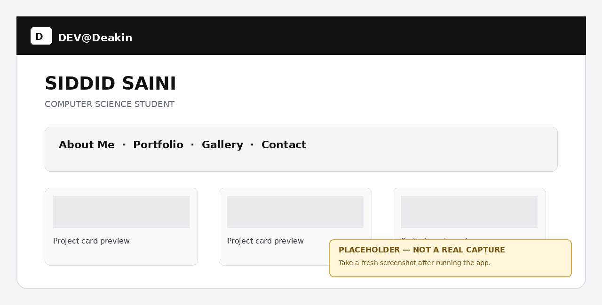
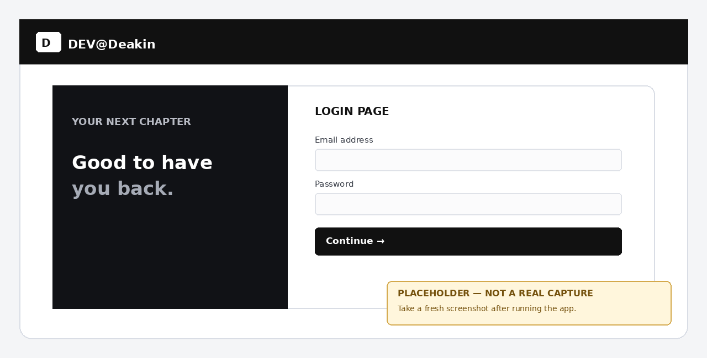
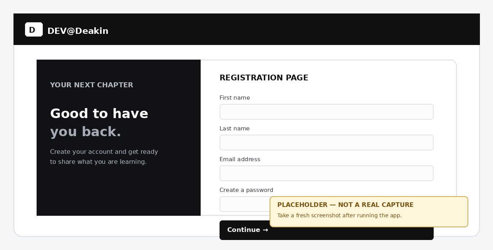

# SIT313 Secure Frontend Applications — P4 Report

**Student:** Siddid Saini  
**Task:** P4 — Login and Registration Page  
**Project:** P3 personal portfolio extended with P4 routes  
**Date:** [insert submission date]

## 1. Overview

This submission extends the existing P3 React portfolio by introducing a reusable navigation bar and footer, React Router routes for login and registration, Firebase Authentication, and a Firestore user profile document. The original portfolio sections, styling, contact form, subscription form, and optional Express email backend have been retained.

## 2. Screenshots

### Homepage and updated navigation

### Login page

### Registration page

> Replace these example screenshots with fresh captures from your running application after Firebase setup. Also capture the successful-registration Firestore profile if your assessor expects evidence of database behaviour.

## 3. Implementation summary

- The DEV@Deakin brand navigates to `/`.
- The `/login` page validates email/password fields and uses Firebase Authentication. Successful sign-in redirects to `/`.
- The `/register` page validates first name, last name, email, password strength, and password confirmation. It creates a Firebase Authentication account, stores non-sensitive profile fields in `users/{uid}` in Cloud Firestore, then redirects to `/login`.
- Passwords are managed by Firebase Authentication and are not stored in Firestore.
- The navbar and footer are shared components across the routes.
- Firebase configuration is supplied through local environment variables, and `.env` is excluded from Git.

## 4. Repository and video

**Task P4 GitLab repository (Internal visibility):** [PASTE YOUR TASK P4 REPOSITORY URL HERE]  
**2–4 minute walkthrough (YouTube or Panopto):** [PASTE YOUR VIDEO LINK HERE]

## 5. Testing summary

| Test | Expected result | Result |
|---|---|---|
| Valid registration | Account created, profile stored, redirected to Login | [Pass/Fail] |
| Existing email | Friendly duplicate-account message | [Pass/Fail] |
| Invalid email | Validation message shown | [Pass/Fail] |
| Weak or mismatched password | Validation message shown | [Pass/Fail] |
| Correct login | Redirected to homepage | [Pass/Fail] |
| Incorrect login | Friendly error and sign-up suggestion | [Pass/Fail] |

## 6. Conclusion

The project adds the requested login and registration flow to the existing P3 portfolio. Before final submission, confirm all tests pass with your Firebase project, paste the actual repository and video links, and replace the example screenshots with current screenshots from the tested application.
